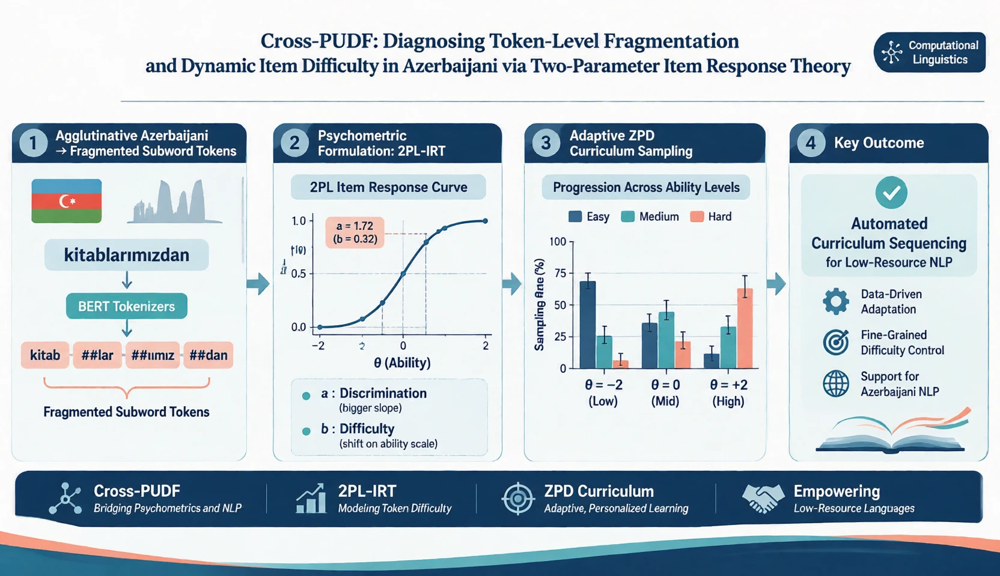
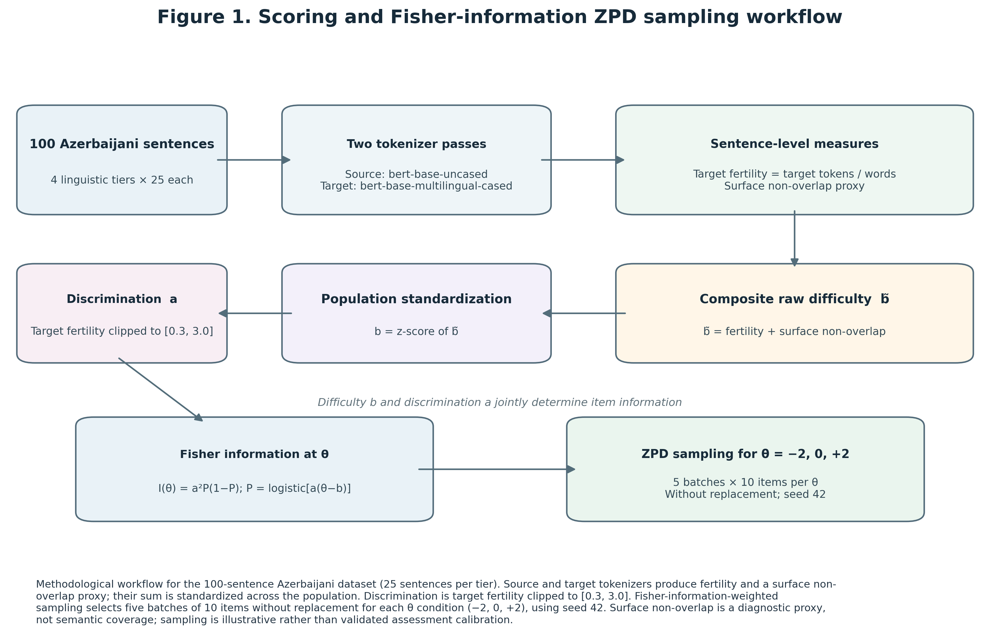
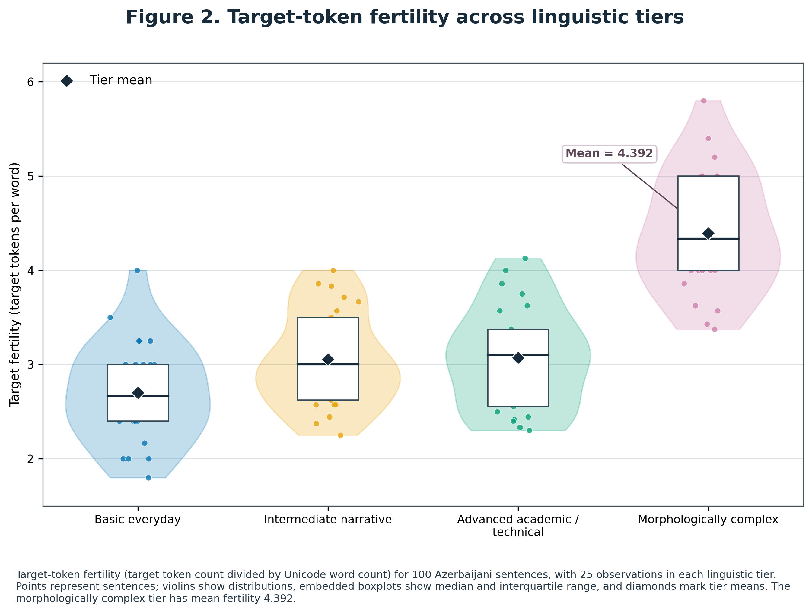
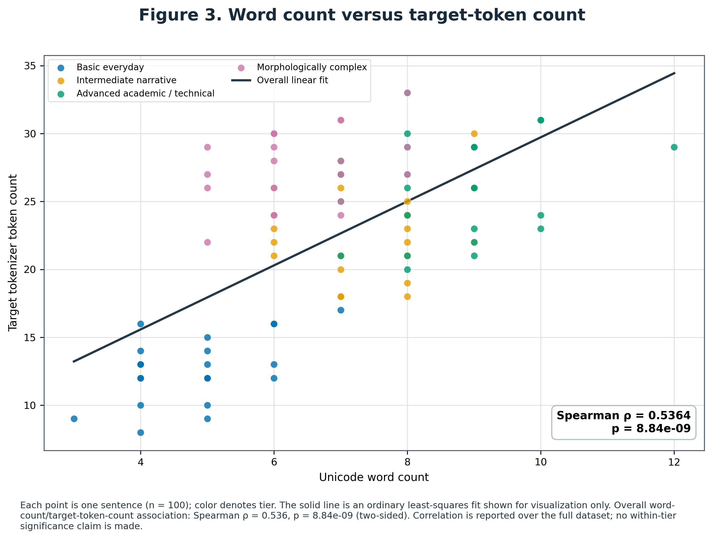
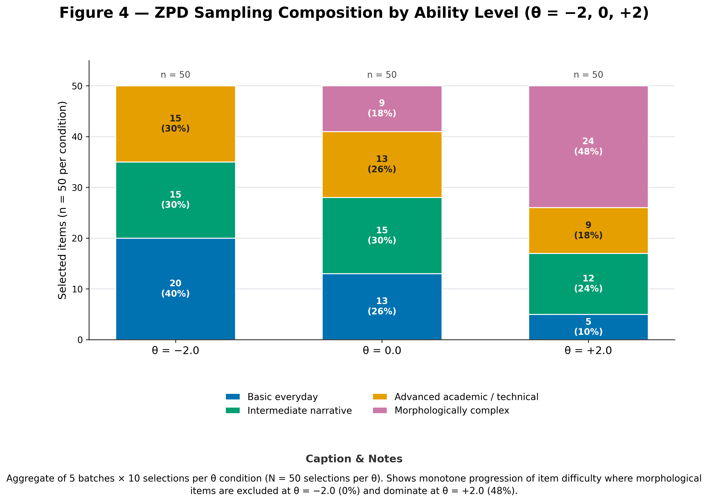
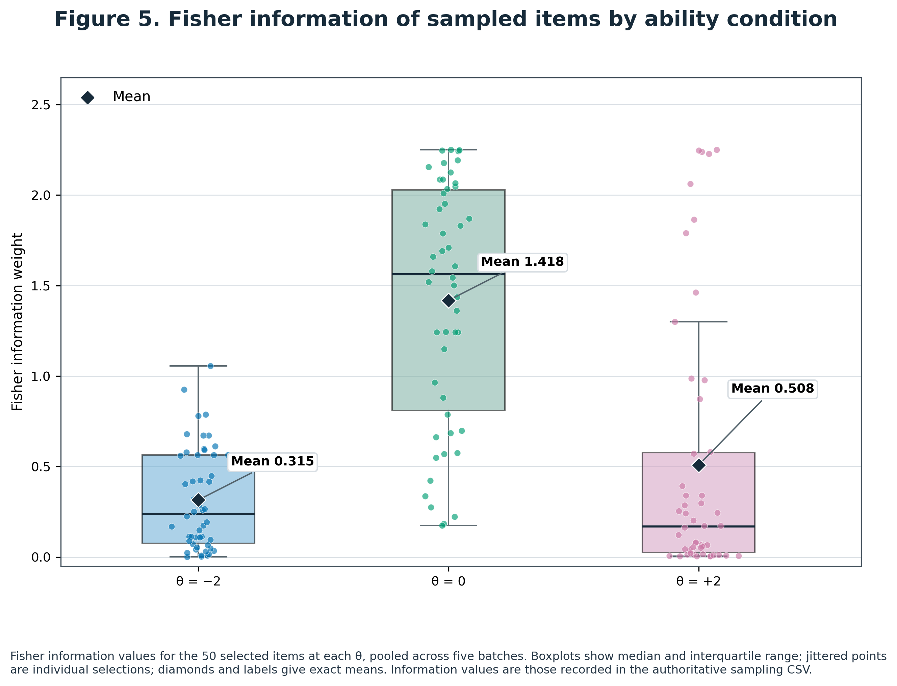

# Cross-PUDF Azerbaijani Token-Level Fragmentation & IRT-Inspired Difficulty

[](#scope-and-status)
[](#dataset)
[](#dataset)
[](#reproduction)
[](LICENSE)

**A small, reproducible exploratory study of tokenizer fragmentation in Azerbaijani Latin-script sentences, with an illustrative IRT-inspired difficulty score and ability-conditioned item-sampling demonstration.** The repository contains sentence-level derived measurements, analysis code, sampling batches, and figures. It is a research artifact—not a validated language assessment, learner model, or calibrated IRT item bank.

> **At a glance:** 100 manually authored sentences (25 in each of four editorial tiers); comparison of `bert-base-uncased` (source) and `bert-base-multilingual-cased` (target); 150 illustrative selections at three ability values; and rank-based as well as descriptive analyses. The most morphologically complex tier has the highest mean target fertility and composite score in this constructed sample. Interpret every tier contrast in light of the small, manually curated corpus and proxy measures.

## Graphical abstract

[](figures/cross_pudf_graphical_abstract_final.png)

## Figures


### Figure 1: Pipeline & Methodological Architecture
<p align="center">
  
</p>

> **Figure 1:** End-to-end analytical pipeline from multilingual vs. monolingual tokenization through empirical fertility estimation, composite item difficulty derivation ($\tilde{b}_i$), 2PL-IRT parameter mapping, and Fisher information-weighted adaptive batch sampling across the latent ability spectrum ($\theta \in \{-2.0, 0.0, 2.0\}$).

---

### Figure 2: Subword Fertility Distributions Across Curricular Tiers
<p align="center">
  
</p>

> **Figure 2:** Token fertility distributions across four distinct linguistic tiers: *Basic Everyday* ($M = 2.699$), *Intermediate Narrative* ($M = 3.055$), *Advanced Academic* ($M = 3.071$), and *Morphologically Complex* ($M = 4.392$). Agrarian and agglutinative affix chains induce severe subword fragmentation in the morphologically complex tier ($H = 51.705, p = 3.46 \times 10^{-11}$).

---

### Figure 3: Item Characteristic Curves (2PL-IRT Model)
<p align="center">
  
</p>

> **Figure 3:** Two-Parameter Logistic Item Characteristic Curves (ICCs) demonstrating the probability of target-level processing $P_i(\theta)$ as a function of latent ability $\theta$. Discrimination parameters $a_i$ clipped to $[0.3, 3.0]$ show ceiling saturation for $64\%$ of items (including $100\%$ of morphologically complex items).

---

### Figure 4: Sentence Length vs. Subword Fragmentation Disjunction
<p align="center">
  
</p>

> **Figure 4:** Bivariate scatter plot of raw word count versus subword token counts, color-coded by tier. While the overall Spearman rank correlation is moderate ($\rho = 0.536, p = 8.84 \times 10^{-9}$), within-tier correlations are non-significant, highlighting that surface word count fails to capture morphological complexity in agglutinative languages.

---

### Figure 5: Adaptive ZPD Batch Progression Across Latent Abilities
<p align="center">
  
</p>

> **Figure 5:** Tier composition across 5 simulated adaptive sampling batches (10 items each) for $\theta = -2.0$, $\theta = 0.0$, and $\theta = +2.0$. The Fisher information-driven curriculum automatically excludes morphologically complex items at low ability ($0\%$) while prioritizing them at advanced ability ($48\%$).

## Scope and status

This package is built around a supplied set of 100 Azerbaijani sentences and derived tokenizer outputs. It provides a transparent analysis of those materials. It does **not** claim a representative sample of Azerbaijani, causal evidence, learner response data, independently estimated IRT parameters, or a fresh end-to-end tokenizer scoring run. Tokenizer model revisions used to create the supplied scores were not pinned, so regenerating scores later may produce differences.

“Cross-PUDF” here refers to the project's comparative, PUDF-inspired exploration of token-level fragmentation and difficulty. It should not be confused with a formal validation or replication of the published PUDF framework.

## Research questions

1. How do source and target token counts and target token fertility vary across four manually assigned sentence tiers?
2. How do a surface-vocabulary non-overlap diagnostic and a composite score vary across tiers?
3. What distributions result when items are sampled by an illustrative 2PL Fisher-information rule at low, middle, and high ability values?

## Dataset

The corpus consists of 100 manually authored Azerbaijani sentences in Latin script, balanced by design across four editorial tiers. Sentence IDs are stable, zero-based row IDs in the supplied scoring output.

| Tier | n | Mean words (SD) | Mean target tokens (SD) | Mean target fertility (SD) | Mean source tokens (SD) | Mean composite `b̃` (SD) |
|---|---:|---:|---:|---:|---:|---:|
| Basic everyday | 25 | 4.76 (0.93) | 12.60 (2.31) | 2.70 (0.53) | 16.28 (3.18) | 3.106 (0.516) |
| Intermediate narrative | 25 | 7.44 (0.87) | 22.52 (3.29) | 3.06 (0.50) | 31.56 (4.73) | 3.569 (0.485) |
| Advanced academic/technical | 25 | 8.64 (1.19) | 26.16 (3.65) | 3.07 (0.54) | 40.24 (4.64) | 3.599 (0.553) |
| Morphologically complex | 25 | 6.32 (0.90) | 27.36 (2.83) | 4.39 (0.64) | 42.68 (4.79) | 4.950 (0.643) |
| **All tiers** | **100** | — | — | — | — | — |

SD is the sample standard deviation. Target fertility is target-token count divided by Unicode-aware word count. Source/target token counts exclude special tokens. The input score table contains token strings and additional raw and scaled fields; see the data dictionary, if included in the repository, for exact column names.

### Measures

- **Target fertility:** `target_token_count / unicode_word_count`.
- **Target/source token ratio:** `target_token_count / source_token_count`.
- **Surface non-overlap proxy:** fraction of target token surface strings whose lowercased form is absent from lowercased source vocabulary strings. This is a simple diagnostic—not lexical coverage, semantic overlap, or a validated linguistic measure. Tokenizer normalization, segmentation and continuation markers can strongly affect it.
- **Composite score:** `b̃ = target_fertility + target_surface_nonoverlap_proxy` (unit weights; zero intercept).
- **Standardized score:** `b̃_z`, calculated using the corpus-wide population standard deviation. Min–max and robustly clipped transformations are also present in the score file.

## Statistical results

### Tier-level omnibus tests

Kruskal–Wallis tests compare the four independent editorial tier groups. Results are reported as `H(3)` and p-values. The tests indicate differences in this particular constructed corpus; they do not show that the tier labels are objective or that the measures generalize beyond these sentences.

| Outcome | Kruskal–Wallis H(3) | p-value |
|---|---:|---:|
| Unicode word count | 70.809 | 2.86 × 10⁻¹⁵ |
| Target fertility | 51.705 | 3.46 × 10⁻¹¹ |
| Composite `b̃` | 56.170 | 3.86 × 10⁻¹² |
| Standardized composite `b̃_z` | 56.170 | 3.86 × 10⁻¹² |

### Pairwise Mann–Whitney U tests

Two-sided pairwise rank tests are shown with Bonferroni adjustment across the six tier comparisons **within each outcome**. Values below are adjusted p-values; `U` is the reported test statistic for the pair as ordered. `p < .05` is not, by itself, evidence that a manually assigned tier is a valid difficulty scale.

| Outcome | Tier 1 | Tier 2 | U | Bonferroni-adjusted p |
|---|---|---|---:|---:|
| Word count | Basic | Intermediate | 14.5 | 2.55 × 10⁻⁸ |
| Word count | Basic | Advanced | 2.0 | 6.89 × 10⁻⁹ |
| Word count | Basic | Morphologically complex | 77.0 | 1.52 × 10⁻⁵ |
| Word count | Intermediate | Advanced | 134.0 | 0.00204 |
| Word count | Intermediate | Morphologically complex | 502.0 | 0.000808 |
| Word count | Advanced | Morphologically complex | 589.0 | 2.89 × 10⁻⁷ |
| Target fertility | Basic | Intermediate | 202.5 | 0.1969 |
| Target fertility | Basic | Advanced | 200.5 | 0.1807 |
| Target fertility | Basic | Morphologically complex | 9.5 | 2.44 × 10⁻⁸ |
| Target fertility | Intermediate | Advanced | 303.5 | 1.0000 |
| Target fertility | Intermediate | Morphologically complex | 28.5 | 2.15 × 10⁻⁷ |
| Target fertility | Advanced | Morphologically complex | 33.0 | 3.55 × 10⁻⁷ |
| Composite `b̃` | Basic | Intermediate | 164.0 | 0.02449 |
| Composite `b̃` | Basic | Advanced | 163.0 | 0.02301 |
| Composite `b̃` | Basic | Morphologically complex | 5.0 | 1.54 × 10⁻⁸ |
| Composite `b̃` | Intermediate | Advanced | 308.5 | 1.0000 |
| Composite `b̃` | Intermediate | Morphologically complex | 24.0 | 1.38 × 10⁻⁷ |
| Composite `b̃` | Advanced | Morphologically complex | 27.0 | 1.92 × 10⁻⁷ |

### Spearman rank-correlation matrix

The following matrix is calculated across all 100 sentences from the supplied scores; entries are Spearman ρ rounded to three decimals. Several score transformations are mechanically derived from the same score and therefore are not independent measures. In particular, the near-perfect correlation of fertility with `b̃` partly follows from the definition of `b̃`.

|  | Words | Source tokens | Target tokens | Target fertility | Target/source ratio | Non-overlap proxy | `b̃` |
|---|---:|---:|---:|---:|---:|---:|---:|
| **Words** | 1.000 | 0.505 | 0.536 | -0.166 | -0.205 | 0.114 | -0.128 |
| **Source tokens** | 0.505 | 1.000 | 0.877 | 0.597 | -0.589 | 0.397 | 0.635 |
| **Target tokens** | 0.536 | 0.877 | 1.000 | 0.680 | -0.201 | 0.180 | 0.688 |
| **Target fertility** | -0.166 | 0.597 | 0.680 | 1.000 | -0.130 | 0.174 | 0.988 |
| **Target/source ratio** | -0.205 | -0.589 | -0.201 | -0.130 | 1.000 | -0.633 | -0.211 |
| **Non-overlap proxy** | 0.114 | 0.397 | 0.180 | 0.174 | -0.633 | 1.000 | 0.305 |
| **`b̃`** | -0.128 | 0.635 | 0.688 | 0.988 | -0.211 | 0.305 | 1.000 |

For the primary length comparison, word count versus target-token count gave Spearman ρ = 0.536, p = 8.84 × 10⁻⁹ (n = 100). The overall association should not be read as within-tier evidence: within-tier correlations were smaller and not statistically significant in these data (basic ρ = 0.371, p = 0.068; intermediate ρ = 0.227, p = 0.274; advanced ρ = 0.178, p = 0.394; morphologically complex ρ = 0.303, p = 0.140; n = 25 per tier).

### IRT-inspired ZPD adaptive-sampling distributions

The supplied sampling output has five batches of ten selections at each `θ ∈ {−2, 0, 2}`. Each batch is sampled without replacement within its ability condition. Counts below pool the five batches (50 selections per θ).

| Ability θ | Basic everyday | Intermediate narrative | Advanced academic/technical | Morphologically complex | Total selections |
|---:|---:|---:|---:|---:|---:|
| -2 | 20 (40%) | 15 (30%) | 15 (30%) | 0 (0%) | 50 |
| 0 | 13 (26%) | 15 (30%) | 13 (26%) | 9 (18%) | 50 |
| +2 | 5 (10%) | 12 (24%) | 9 (18%) | 24 (48%) | 50 |

This progression is consistent with the stated selection rule for these inputs, not a learner-outcome result. Pooled tier-by-ability counts differed (`χ²(6) = 37.56`, `p = 1.37 × 10⁻⁶`; minimum expected count = 11). Because sentence tier is manually assigned and the 2PL values are not calibrated, the test is descriptive of the generated draws—not evidence for adaptive instructional benefit.

### Ceiling constraints

Discrimination `a` is defined as target fertility clipped to the interval `[0.3, 3.0]`. Consequently, a value of exactly 3.0 is a **hard computational ceiling**, not an empirically estimated high-discrimination item. The ceiling is frequent in selected samples and compresses their discrimination values.

| θ | Selected records (n) | Selected with `a = 3` | Selection proportion | Unique items with `a = 3` |
|---:|---:|---:|---:|---:|
| -2 | 50 | 17 | 34% | 17 / 50 |
| 0 | 50 | 38 | 76% | 38 / 50 |
| +2 | 50 | 45 | 90% | 45 / 50 |

The sampled mean discrimination was 2.639 at θ = -2, 2.894 at θ = 0, and 2.972 at θ = +2. There were 96 distinct items across all 150 selections. Pairwise unique-item Jaccard overlap was 0.351 for θ = -2 versus 0, 0.124 for -2 versus +2, and 0.299 for 0 versus +2; six items were common to all three conditions. These overlap summaries are consequences of this particular seeded sampling output and pool.

The illustrative selection quantities are computed as:

```text
b = corpus-wide z-score of b̃
a = clip(target fertility, 0.3, 3.0)
P(θ) = 1 / (1 + exp(-a * (θ - b)))
Fisher information = a² * P(θ) * (1 - P(θ))
```

Weights are renormalized over the remaining items at every sequential draw. This procedure is a demonstration only: `a` and `b` are proxies, not parameters fitted to response data, and no student response or ability estimates are available.

## Conclusion

In this 100-sentence constructed sample, the morphologically complex tier has the largest average target fertility and composite `b̃`, and target-token counts rise with sentence word count overall. Rank-based tests also distinguish several tier distributions. However, the composite incorporates a deliberately crude vocabulary-surface proxy, the tiers are editorial labels, tokenizer versions were not fixed, and the apparent adaptive pattern arises from a clipped, uncalibrated 2PL-style selection rule. The appropriate conclusion is therefore **descriptive and hypothesis-generating**: the outputs motivate larger, independently curated and linguistically validated Azerbaijani data, pinned tokenizer versions, and real response data before making claims about language difficulty, learner proficiency, or educational effectiveness.

## Repository contents

Expected repository paths (names may differ slightly between releases):

```text
.
├── README.md
├── LICENSE
├── figures/
│   ├── cross_pudf_figure_1.png ... cross_pudf_figure_4.png
│   └── cross_pudf_graphical_abstract_final.png
├── data/
│   ├── cross_pudf_100_sentences_scores.csv
│   └── cross_pudf_sampling_batches.csv
├── scripts/
│   ├── cross_pudf_analysis.py
│   └── cross_pudf_analysis.R
└── results/
    └── cross_pudf_analysis_results.txt
```

The score CSV is the analysis input and includes sentence text, tokenizer names, token strings/counts, proxies, score transforms, and ranks. The sampling CSV records theta/batch item draws and associated selection quantities. Do not treat a reconstructed “raw” CSV extracted from derived outputs as an independently collected raw source.

## Reproduction

### Python analysis

Use Python 3.9 or newer. From the repository root, install the analysis dependencies and run:

```bash
python -m pip install -r requirements.txt
python scripts/cross_pudf_analysis.py
```

If the script supports alternate input paths, they can be passed positionally:

```bash
python scripts/cross_pudf_analysis.py path/to/scores.csv path/to/sampling.csv
```

The analysis expects 100 score rows across four tiers and 150 sampling selections (five batches × ten items × three theta values). Its output includes descriptive summaries, normality diagnostics, ANOVA/Kruskal–Wallis tests, pairwise Tukey and Mann–Whitney results, correlations, sampling distributions, ceiling proportions, and overlap diagnostics. If a release includes a saved analysis transcript, compare the fresh output with `results/cross_pudf_analysis_results.txt`.

### Optional R analysis

If the R script is included, run it from the repository root with base R:

```bash
Rscript scripts/cross_pudf_analysis.R
```

A script being present does not mean it was executed for every packaged release; consult the release's results/transcript for what was actually run.

### Re-scoring tokenizers (optional)

The supplied score CSV contains derived outputs from Hugging Face tokenizers. Recreating those outputs requires network access, compatible Python/Transformers dependencies, and the model/tokenizer repositories. The relevant pair is `bert-base-uncased` and `bert-base-multilingual-cased`. Record exact package versions and immutable model revisions for any new run. Do not expect bit-for-bit equality with the unpinned historical outputs.

## Caveats and responsible interpretation

- **Small constructed corpus:** 25 manually written examples per editorial tier; not representative or randomly sampled Azerbaijani.
- **Proxy validity:** lowercased surface-string comparison across different vocabularies is not a validated cross-lingual coverage or semantic measure.
- **No response data:** no human learner responses, psychometric calibration, validated item parameters, or measured student ability are supplied.
- **Ceiling effects:** clipping `a` at 3.0 makes up to 90% of selected items hit the ceiling at θ = +2.
- **Unpinned models:** the tokenizer revisions used to create the derived data may be unavailable or may change.
- **Exploratory inference:** many measures are mathematically dependent; p-values do not correct design limitations or turn editorial tiers into validated difficulty categories.
- **Licensing:** the software license does not automatically establish permission to reuse sentence text, model vocabularies, figures, or the related published article. Check rights and licenses for each component before redistribution or commercial use.

## Citation

If you use this repository, cite the repository release and include its version or commit hash. No dataset DOI is asserted here; add a DOI after archiving a specific release (for example, with Zenodo), and replace this placeholder with the actual DOI and full authorship before publication:

```text
Pegi1727. Cross-PUDF Azerbaijani Token-Level Fragmentation & Item Response Theory.
GitHub repository, version [release/tag or commit], [year]. [repository URL]. DOI: [add archived-release DOI when available].
```

For the conceptual PUDF framework, cite the published article below. It is related background, **not** the source of the Azerbaijani corpus or the analyses reported above:

> Meng, Guangyu, Qingkai Zeng, John P. Lalor, and Hong Yu. 2026. “A Psychology-based Unified Dynamic Framework for Curriculum Learning.” *Computational Linguistics* 52(3): 1001–1047. https://doi.org/10.1162/COLI.a.584

## License

The repository's code is distributed under the MIT License; see [`LICENSE`](LICENSE). The MIT license applies only to material covered by that license and does not automatically license third-party assets, underlying model/tokenizer materials, or the published article. Confirm the provenance and reuse rights of the sentence corpus, figures, and any derived content before redistribution. The cited PUDF article is published under CC BY-NC-ND 4.0; consult its publisher version for the exact terms applicable to that article.

---

*For issues or corrections, please include the repository version, the exact input-file names, and the command used to reproduce the result.*
